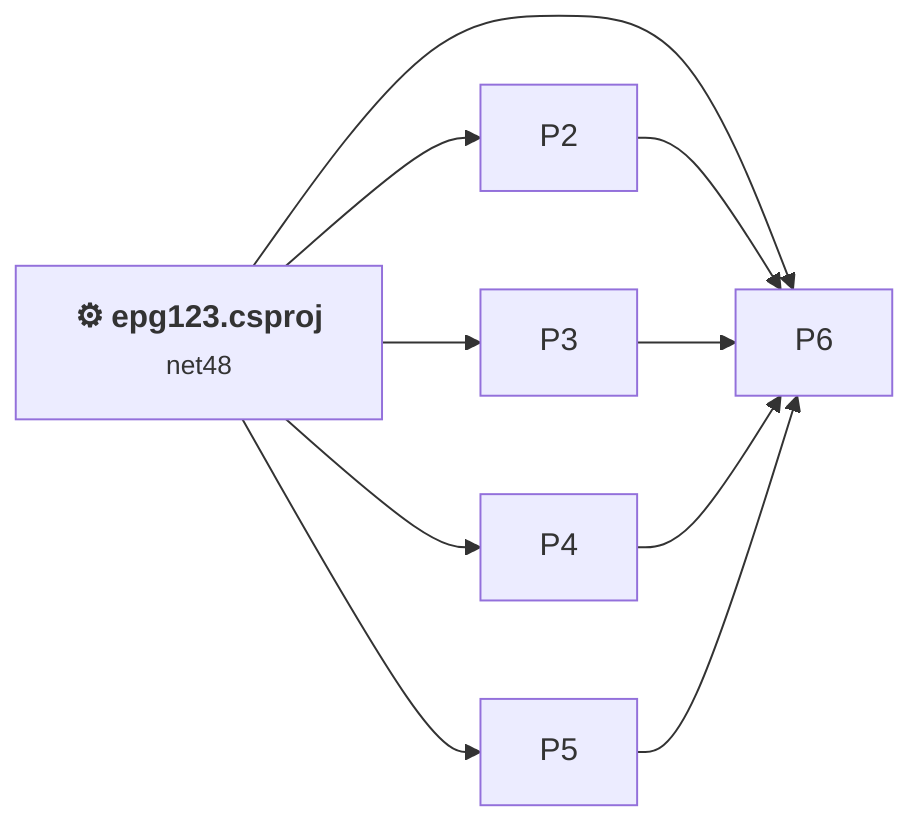
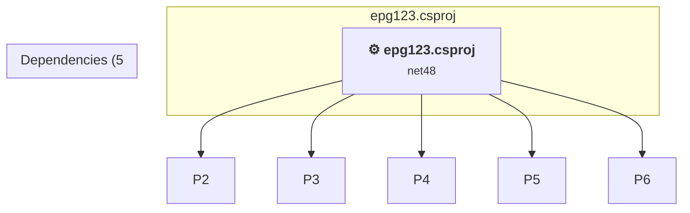

# Projects and dependencies analysis

This document provides a comprehensive overview of the projects and their dependencies in the context of upgrading to .NETCoreApp,Version=v10.0.

## Table of Contents

- [Executive Summary](#executive-Summary)
  - [Highlevel Metrics](#highlevel-metrics)
  - [Projects Compatibility](#projects-compatibility)
  - [Package Compatibility](#package-compatibility)
  - [API Compatibility](#api-compatibility)
  - [Binding Redirect Configuration](#binding-redirect-configuration)
- [Aggregate NuGet packages details](#aggregate-nuget-packages-details)
- [Top API Migration Challenges](#top-api-migration-challenges)
  - [Technologies and Features](#technologies-and-features)
  - [Most Frequent API Issues](#most-frequent-api-issues)
- [Projects Relationship Graph](#projects-relationship-graph)
- [Project Details](#project-details)

  - [%USERPROFILE%\source\repos\epg123\src\GaRyan2.Github\GaRyan2.Github.csproj](#%userprofile%sourcereposepg123srcgaryan2githubgaryan2githubcsproj)
  - [%USERPROFILE%\source\repos\epg123\src\GaRyan2.MxfXmltvTools\GaRyan2.MxfXmltvTools.csproj](#%userprofile%sourcereposepg123srcgaryan2mxfxmltvtoolsgaryan2mxfxmltvtoolscsproj)
  - [%USERPROFILE%\source\repos\epg123\src\GaRyan2.SchedulesDirect\GaRyan2.SchedulesDirect.csproj](#%userprofile%sourcereposepg123srcgaryan2schedulesdirectgaryan2schedulesdirectcsproj)
  - [%USERPROFILE%\source\repos\epg123\src\GaRyan2.Tmdb\GaRyan2.Tmdb.csproj](#%userprofile%sourcereposepg123srcgaryan2tmdbgaryan2tmdbcsproj)
  - [%USERPROFILE%\source\repos\epg123\src\GaRyan2.Utilities\GaRyan2.Utilities.csproj](#%userprofile%sourcereposepg123srcgaryan2utilitiesgaryan2utilitiescsproj)
  - [epg123.csproj](#epg123csproj)

## Executive Summary

### Highlevel Metrics

| Metric | Count | Status |
| :--- | :---: | :--- |
| Total Projects | 6 | 3 require upgrade |
| Total NuGet Packages | 0 | All compatible |
| Total Code Files | 119 |  |
| Total Code Files with Incidents | 15 |  |
| Total Lines of Code | 12847 |  |
| Total Number of Issues | 361 |  |
| Estimated LOC to modify | 353+ | at least 2.7% of codebase |

### Projects Compatibility

| Project | Target Framework | Difficulty | Package Issues | API Issues | Binding Issues | Est. LOC Impact | Description |
| :--- | :---: | :---: | :---: | :---: | :---: | :---: | :--- |
| [%USERPROFILE%\source\repos\epg123\src\GaRyan2.Github\GaRyan2.Github.csproj](#%userprofile%sourcereposepg123srcgaryan2githubgaryan2githubcsproj) | net10.0-windows | ✅ None | 0 | 0 | 0 |  | ClassLibrary, Sdk Style = True |
| [%USERPROFILE%\source\repos\epg123\src\GaRyan2.MxfXmltvTools\GaRyan2.MxfXmltvTools.csproj](#%userprofile%sourcereposepg123srcgaryan2mxfxmltvtoolsgaryan2mxfxmltvtoolscsproj) | net48 | 🟢 Low | 0 | 1 | 0 | 1+ | ClassicClassLibrary, Sdk Style = False |
| [%USERPROFILE%\source\repos\epg123\src\GaRyan2.SchedulesDirect\GaRyan2.SchedulesDirect.csproj](#%userprofile%sourcereposepg123srcgaryan2schedulesdirectgaryan2schedulesdirectcsproj) | net10.0-windows | ✅ None | 0 | 0 | 0 |  | ClassLibrary, Sdk Style = True |
| [%USERPROFILE%\source\repos\epg123\src\GaRyan2.Tmdb\GaRyan2.Tmdb.csproj](#%userprofile%sourcereposepg123srcgaryan2tmdbgaryan2tmdbcsproj) | net48 | 🟢 Low | 1 | 1 | 0 | 1+ | ClassicClassLibrary, Sdk Style = False |
| [%USERPROFILE%\source\repos\epg123\src\GaRyan2.Utilities\GaRyan2.Utilities.csproj](#%userprofile%sourcereposepg123srcgaryan2utilitiesgaryan2utilitiescsproj) | net10.0-windows | ✅ None | 0 | 0 | 0 |  | ClassLibrary, Sdk Style = True |
| [epg123.csproj](#epg123csproj) | net48 | 🟡 Medium | 1 | 351 | 0 | 351+ | ClassicWinForms, Sdk Style = False |

### Package Compatibility

| Status | Count | Percentage |
| :--- | :---: | :---: |
| ✅ Compatible | 0 | 0.0% |
| ⚠️ Incompatible | 0 | 0.0% |
| 🔄 Upgrade Recommended | 0 | 0.0% |
| ***Total NuGet Packages*** | ***0*** | ***100%*** |

### API Compatibility

| Category | Count | Impact |
| :--- | :---: | :--- |
| 🔴 Binary Incompatible | 227 | High - Require code changes |
| 🟡 Source Incompatible | 123 | Medium - Needs re-compilation and potential conflicting API error fixing |
| 🔵 Behavioral change | 3 | Low - Behavioral changes that may require testing at runtime |
| ✅ Compatible | 10591 |  |
| ***Total APIs Analyzed*** | ***10944*** |  |

## Aggregate NuGet packages details

| Package | Current Version | Suggested Version | Projects | Description |
| :--- | :---: | :---: | :--- | :--- |

## Top API Migration Challenges

### Technologies and Features

| Technology | Issues | Percentage | Migration Path |
| :--- | :---: | :---: | :--- |
| Windows Forms | 227 | 64.3% | Windows Forms APIs for building Windows desktop applications with traditional Forms-based UI that are available in .NET on Windows. Enable Windows Desktop support: Option 1 (Recommended): Target net9.0-windows; Option 2: Add <UseWindowsDesktop>true</UseWindowsDesktop>; Option 3 (Legacy): Use Microsoft.NET.Sdk.WindowsDesktop SDK. |
| GDI+ / System.Drawing | 114 | 32.3% | System.Drawing APIs for 2D graphics, imaging, and printing that are available via NuGet package System.Drawing.Common. Note: Not recommended for server scenarios due to Windows dependencies; consider cross-platform alternatives like SkiaSharp or ImageSharp for new code. |
| Legacy Configuration System | 2 | 0.6% | Legacy XML-based configuration system (app.config/web.config) that has been replaced by a more flexible configuration model in .NET Core. The old system was rigid and XML-based. Migrate to Microsoft.Extensions.Configuration with JSON/environment variables; use System.Configuration.ConfigurationManager NuGet package as interim bridge if needed. |

### Most Frequent API Issues

| API | Count | Percentage | Category |
| :--- | :---: | :---: | :--- |
| T:System.Windows.Forms.Label | 44 | 12.5% | Binary Incompatible |
| T:System.Windows.Forms.ProgressBar | 32 | 9.1% | Binary Incompatible |
| T:System.Drawing.Bitmap | 26 | 7.4% | Source Incompatible |
| T:System.Drawing.Image | 10 | 2.8% | Source Incompatible |
| T:System.Windows.Forms.AnchorStyles | 10 | 2.8% | Binary Incompatible |
| P:System.Drawing.Image.Width | 8 | 2.3% | Source Incompatible |
| P:System.Windows.Forms.Control.Name | 7 | 2.0% | Binary Incompatible |
| P:System.Windows.Forms.Label.Text | 7 | 2.0% | Binary Incompatible |
| T:System.Drawing.Imaging.ImageFormat | 6 | 1.7% | Source Incompatible |
| T:System.Windows.Forms.Control.ControlCollection | 6 | 1.7% | Binary Incompatible |
| P:System.Windows.Forms.Control.Controls | 6 | 1.7% | Binary Incompatible |
| M:System.Windows.Forms.Control.ControlCollection.Add(System.Windows.Forms.Control) | 6 | 1.7% | Binary Incompatible |
| T:System.Drawing.ContentAlignment | 6 | 1.7% | Source Incompatible |
| P:System.Windows.Forms.Control.TabIndex | 6 | 1.7% | Binary Incompatible |
| P:System.Windows.Forms.Control.Size | 6 | 1.7% | Binary Incompatible |
| P:System.Windows.Forms.Control.Location | 6 | 1.7% | Binary Incompatible |
| T:System.Windows.Forms.ProgressBarStyle | 6 | 1.7% | Binary Incompatible |
| P:System.Windows.Forms.ProgressBar.Maximum | 6 | 1.7% | Binary Incompatible |
| P:System.Windows.Forms.ProgressBar.Value | 6 | 1.7% | Binary Incompatible |
| M:System.TimeSpan.FromSeconds(System.Double) | 4 | 1.1% | Source Incompatible |
| T:System.Drawing.Graphics | 4 | 1.1% | Source Incompatible |
| M:System.Drawing.Bitmap.#ctor(System.Int32,System.Int32) | 4 | 1.1% | Source Incompatible |
| T:System.Windows.Forms.DialogResult | 4 | 1.1% | Binary Incompatible |
| M:System.Windows.Forms.Label.#ctor | 4 | 1.1% | Binary Incompatible |
| P:System.Drawing.Imaging.ImageFormat.Png | 3 | 0.8% | Source Incompatible |
| M:System.Drawing.Image.FromFile(System.String) | 3 | 0.8% | Source Incompatible |
| P:System.Drawing.Image.Height | 3 | 0.8% | Source Incompatible |
| T:System.Drawing.Text.TextRenderingHint | 3 | 0.8% | Source Incompatible |
| T:System.Drawing.Drawing2D.SmoothingMode | 3 | 0.8% | Source Incompatible |
| T:System.Windows.Forms.FormStartPosition | 3 | 0.8% | Binary Incompatible |
| T:System.Windows.Forms.SizeGripStyle | 3 | 0.8% | Binary Incompatible |
| T:System.Windows.Forms.FormBorderStyle | 3 | 0.8% | Binary Incompatible |
| T:System.Windows.Forms.AutoScaleMode | 3 | 0.8% | Binary Incompatible |
| M:System.Drawing.Image.Save(System.IO.Stream,System.Drawing.Imaging.ImageFormat) | 2 | 0.6% | Source Incompatible |
| T:System.Uri | 2 | 0.6% | Behavioral Change |
| M:System.Drawing.Graphics.FromImage(System.Drawing.Image) | 2 | 0.6% | Source Incompatible |
| T:System.Drawing.GraphicsUnit | 2 | 0.6% | Source Incompatible |
| T:System.Drawing.FontStyle | 2 | 0.6% | Source Incompatible |
| T:System.Drawing.FontFamily | 2 | 0.6% | Source Incompatible |
| T:System.Windows.Forms.FormClosingEventHandler | 2 | 0.6% | Binary Incompatible |
| F:System.Drawing.ContentAlignment.TopRight | 2 | 0.6% | Source Incompatible |
| P:System.Windows.Forms.Label.TextAlign | 2 | 0.6% | Binary Incompatible |
| F:System.Windows.Forms.AnchorStyles.Right | 2 | 0.6% | Binary Incompatible |
| F:System.Windows.Forms.AnchorStyles.Top | 2 | 0.6% | Binary Incompatible |
| P:System.Windows.Forms.Control.Anchor | 2 | 0.6% | Binary Incompatible |
| F:System.Windows.Forms.ProgressBarStyle.Continuous | 2 | 0.6% | Binary Incompatible |
| P:System.Windows.Forms.ProgressBar.Style | 2 | 0.6% | Binary Incompatible |
| P:System.Windows.Forms.ProgressBar.Step | 2 | 0.6% | Binary Incompatible |
| M:System.Windows.Forms.ProgressBar.#ctor | 2 | 0.6% | Binary Incompatible |
| T:System.Windows.Forms.MessageBoxButtons | 2 | 0.6% | Binary Incompatible |

## Projects Relationship Graph

Legend:
📦 SDK-style project
⚙️ Classic project

## Project Details

### epg123.csproj

#### Project Info

- **Current Target Framework:** net48
- **Proposed Target Framework:** net10.0-windows
- **SDK-style**: False
- **Project Kind:** ClassicWinForms
- **Dependencies**: 5
- **Dependants**: 0
- **Number of Files**: 26
- **Number of Files with Incidents**: 11
- **Lines of Code**: 4530
- **Estimated LOC to modify**: 351+ (at least 7.7% of the project)

#### Dependency Graph

Legend:
📦 SDK-style project
⚙️ Classic project

### API Compatibility

| Category | Count | Impact |
| :--- | :---: | :--- |
| 🔴 Binary Incompatible | 227 | High - Require code changes |
| 🟡 Source Incompatible | 122 | Medium - Needs re-compilation and potential conflicting API error fixing |
| 🔵 Behavioral change | 2 | Low - Behavioral changes that may require testing at runtime |
| ✅ Compatible | 5166 |  |
| ***Total APIs Analyzed*** | ***5517*** |  |

#### Project Technologies and Features

| Technology | Issues | Percentage | Migration Path |
| :--- | :---: | :---: | :--- |
| Legacy Configuration System | 2 | 0.6% | Legacy XML-based configuration system (app.config/web.config) that has been replaced by a more flexible configuration model in .NET Core. The old system was rigid and XML-based. Migrate to Microsoft.Extensions.Configuration with JSON/environment variables; use System.Configuration.ConfigurationManager NuGet package as interim bridge if needed. |
| GDI+ / System.Drawing | 114 | 32.5% | System.Drawing APIs for 2D graphics, imaging, and printing that are available via NuGet package System.Drawing.Common. Note: Not recommended for server scenarios due to Windows dependencies; consider cross-platform alternatives like SkiaSharp or ImageSharp for new code. |
| Windows Forms | 227 | 64.7% | Windows Forms APIs for building Windows desktop applications with traditional Forms-based UI that are available in .NET on Windows. Enable Windows Desktop support: Option 1 (Recommended): Target net9.0-windows; Option 2: Add <UseWindowsDesktop>true</UseWindowsDesktop>; Option 3 (Legacy): Use Microsoft.NET.Sdk.WindowsDesktop SDK. |

