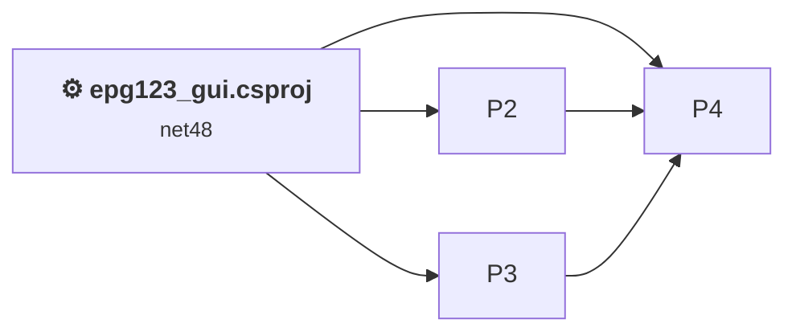
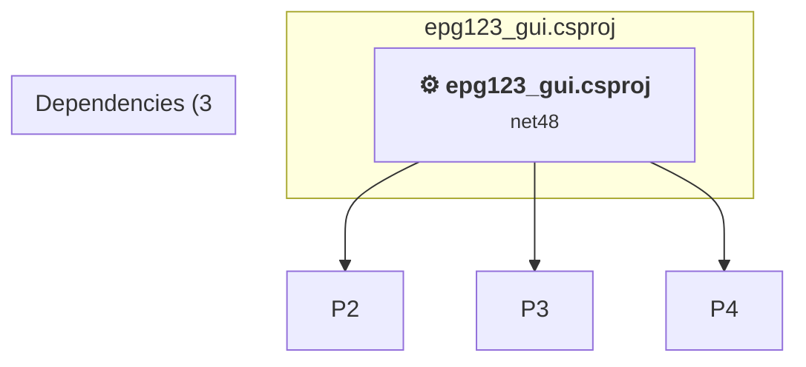

# Projects and dependencies analysis

This document provides a comprehensive overview of the projects and their dependencies in the context of upgrading to .NETCoreApp,Version=v10.0.

## Table of Contents

- [Executive Summary](#executive-Summary)
  - [Highlevel Metrics](#highlevel-metrics)
  - [Projects Compatibility](#projects-compatibility)
  - [Package Compatibility](#package-compatibility)
  - [API Compatibility](#api-compatibility)
  - [Binding Redirect Configuration](#binding-redirect-configuration)
- [Aggregate NuGet packages details](#aggregate-nuget-packages-details)
- [Top API Migration Challenges](#top-api-migration-challenges)
  - [Technologies and Features](#technologies-and-features)
  - [Most Frequent API Issues](#most-frequent-api-issues)
- [Projects Relationship Graph](#projects-relationship-graph)
- [Project Details](#project-details)

  - [%USERPROFILE%\source\repos\epg123\src\GaRyan2.Github\GaRyan2.Github.csproj](#%userprofile%sourcereposepg123srcgaryan2githubgaryan2githubcsproj)
  - [%USERPROFILE%\source\repos\epg123\src\GaRyan2.SchedulesDirect\GaRyan2.SchedulesDirect.csproj](#%userprofile%sourcereposepg123srcgaryan2schedulesdirectgaryan2schedulesdirectcsproj)
  - [%USERPROFILE%\source\repos\epg123\src\GaRyan2.Utilities\GaRyan2.Utilities.csproj](#%userprofile%sourcereposepg123srcgaryan2utilitiesgaryan2utilitiescsproj)
  - [epg123_gui.csproj](#epg123_guicsproj)

## Executive Summary

### Highlevel Metrics

| Metric | Count | Status |
| :--- | :---: | :--- |
| Total Projects | 4 | All require upgrade |
| Total NuGet Packages | 0 | All compatible |
| Total Code Files | 63 |  |
| Total Code Files with Incidents | 32 |  |
| Total Lines of Code | 10010 |  |
| Total Number of Issues | 7502 |  |
| Estimated LOC to modify | 7491+ | at least 74.8% of codebase |

### Projects Compatibility

| Project | Target Framework | Difficulty | Package Issues | API Issues | Binding Issues | Est. LOC Impact | Description |
| :--- | :---: | :---: | :---: | :---: | :---: | :---: | :--- |
| [%USERPROFILE%\source\repos\epg123\src\GaRyan2.Github\GaRyan2.Github.csproj](#%userprofile%sourcereposepg123srcgaryan2githubgaryan2githubcsproj) | net48 | 🟢 Low | 1 | 0 | 0 |  | ClassicClassLibrary, Sdk Style = False |
| [%USERPROFILE%\source\repos\epg123\src\GaRyan2.SchedulesDirect\GaRyan2.SchedulesDirect.csproj](#%userprofile%sourcereposepg123srcgaryan2schedulesdirectgaryan2schedulesdirectcsproj) | net48 | 🟢 Low | 1 | 17 | 0 | 17+ | ClassicWinForms, Sdk Style = False |
| [%USERPROFILE%\source\repos\epg123\src\GaRyan2.Utilities\GaRyan2.Utilities.csproj](#%userprofile%sourcereposepg123srcgaryan2utilitiesgaryan2utilitiescsproj) | net48 | 🟡 Medium | 1 | 661 | 0 | 661+ | ClassicWinForms, Sdk Style = False |
| [epg123_gui.csproj](#epg123_guicsproj) | net48 | 🟡 Medium | 0 | 6813 | 0 | 6813+ | ClassicWinForms, Sdk Style = False |

### Package Compatibility

| Status | Count | Percentage |
| :--- | :---: | :---: |
| ✅ Compatible | 0 | 0.0% |
| ⚠️ Incompatible | 0 | 0.0% |
| 🔄 Upgrade Recommended | 0 | 0.0% |
| ***Total NuGet Packages*** | ***0*** | ***100%*** |

### API Compatibility

| Category | Count | Impact |
| :--- | :---: | :--- |
| 🔴 Binary Incompatible | 6846 | High - Require code changes |
| 🟡 Source Incompatible | 605 | Medium - Needs re-compilation and potential conflicting API error fixing |
| 🔵 Behavioral change | 40 | Low - Behavioral changes that may require testing at runtime |
| ✅ Compatible | 11171 |  |
| ***Total APIs Analyzed*** | ***18662*** |  |

## Aggregate NuGet packages details

| Package | Current Version | Suggested Version | Projects | Description |
| :--- | :---: | :---: | :--- | :--- |

## Top API Migration Challenges

### Technologies and Features

| Technology | Issues | Percentage | Migration Path |
| :--- | :---: | :---: | :--- |
| Windows Forms | 6846 | 91.4% | Windows Forms APIs for building Windows desktop applications with traditional Forms-based UI that are available in .NET on Windows. Enable Windows Desktop support: Option 1 (Recommended): Target net9.0-windows; Option 2: Add <UseWindowsDesktop>true</UseWindowsDesktop>; Option 3 (Legacy): Use Microsoft.NET.Sdk.WindowsDesktop SDK. |
| GDI+ / System.Drawing | 523 | 7.0% | System.Drawing APIs for 2D graphics, imaging, and printing that are available via NuGet package System.Drawing.Common. Note: Not recommended for server scenarios due to Windows dependencies; consider cross-platform alternatives like SkiaSharp or ImageSharp for new code. |
| Legacy Configuration System | 19 | 0.3% | Legacy XML-based configuration system (app.config/web.config) that has been replaced by a more flexible configuration model in .NET Core. The old system was rigid and XML-based. Migrate to Microsoft.Extensions.Configuration with JSON/environment variables; use System.Configuration.ConfigurationManager NuGet package as interim bridge if needed. |
| Windows Forms Legacy Controls | 2 | 0.0% | Legacy Windows Forms controls that have been removed from .NET Core/5+ including StatusBar, DataGrid, ContextMenu, MainMenu, MenuItem, and ToolBar. These controls were replaced by more modern alternatives. Use ToolStrip, MenuStrip, ContextMenuStrip, and DataGridView instead. |

### Most Frequent API Issues

| API | Count | Percentage | Category |
| :--- | :---: | :---: | :--- |
| T:System.Windows.Forms.CheckBox | 501 | 6.7% | Binary Incompatible |
| T:System.Windows.Forms.Label | 390 | 5.2% | Binary Incompatible |
| T:System.Windows.Forms.PictureBox | 239 | 3.2% | Binary Incompatible |
| T:System.Windows.Forms.Button | 226 | 3.0% | Binary Incompatible |
| T:System.Windows.Forms.TextBox | 159 | 2.1% | Binary Incompatible |
| P:System.Windows.Forms.Control.Name | 156 | 2.1% | Binary Incompatible |
| P:System.Windows.Forms.Control.Size | 149 | 2.0% | Binary Incompatible |
| T:System.Windows.Forms.ListView | 148 | 2.0% | Binary Incompatible |
| T:System.Windows.Forms.Control.ControlCollection | 147 | 2.0% | Binary Incompatible |
| P:System.Windows.Forms.Control.Controls | 147 | 2.0% | Binary Incompatible |
| M:System.Windows.Forms.Control.ControlCollection.Add(System.Windows.Forms.Control) | 147 | 2.0% | Binary Incompatible |
| T:System.Windows.Forms.TabPage | 145 | 1.9% | Binary Incompatible |
| P:System.Windows.Forms.Control.Location | 141 | 1.9% | Binary Incompatible |
| P:System.Windows.Forms.Control.TabIndex | 129 | 1.7% | Binary Incompatible |
| T:System.Windows.Forms.RadioButton | 118 | 1.6% | Binary Incompatible |
| P:System.Windows.Forms.Control.Enabled | 97 | 1.3% | Binary Incompatible |
| T:System.Windows.Forms.ComboBox | 89 | 1.2% | Binary Incompatible |
| P:System.Windows.Forms.CheckBox.Checked | 85 | 1.1% | Binary Incompatible |
| T:System.Windows.Forms.ColumnHeader | 82 | 1.1% | Binary Incompatible |
| T:System.Windows.Forms.GroupBox | 77 | 1.0% | Binary Incompatible |
| T:System.Windows.Forms.ToolStripButton | 75 | 1.0% | Binary Incompatible |
| T:System.Windows.Forms.AnchorStyles | 74 | 1.0% | Binary Incompatible |
| T:System.Windows.Forms.SortOrder | 64 | 0.9% | Binary Incompatible |
| P:System.Windows.Forms.ButtonBase.Text | 60 | 0.8% | Binary Incompatible |
| T:System.Windows.Forms.LinkLabel | 60 | 0.8% | Binary Incompatible |
| P:System.Windows.Forms.ButtonBase.UseVisualStyleBackColor | 55 | 0.7% | Binary Incompatible |
| T:System.Windows.Forms.ToolStripMenuItem | 54 | 0.7% | Binary Incompatible |
| T:System.Drawing.Bitmap | 54 | 0.7% | Source Incompatible |
| P:System.Windows.Forms.TextBox.Text | 46 | 0.6% | Binary Incompatible |
| T:System.Drawing.FontStyle | 46 | 0.6% | Source Incompatible |
| T:System.Drawing.Font | 46 | 0.6% | Source Incompatible |
| T:System.Drawing.Image | 45 | 0.6% | Source Incompatible |
| P:System.Windows.Forms.Label.Text | 43 | 0.6% | Binary Incompatible |
| T:System.Windows.Forms.NumericUpDown | 43 | 0.6% | Binary Incompatible |
| T:System.Windows.Forms.ToolStrip | 41 | 0.5% | Binary Incompatible |
| T:System.Windows.Forms.TabControl | 41 | 0.5% | Binary Incompatible |
| T:System.Windows.Forms.DialogResult | 38 | 0.5% | Binary Incompatible |
| P:System.Windows.Forms.ButtonBase.AutoSize | 37 | 0.5% | Binary Incompatible |
| T:System.Windows.Forms.PictureBoxSizeMode | 36 | 0.5% | Binary Incompatible |
| T:System.Windows.Forms.BorderStyle | 36 | 0.5% | Binary Incompatible |
| M:System.Windows.Forms.Label.#ctor | 35 | 0.5% | Binary Incompatible |
| P:System.Windows.Forms.Label.AutoSize | 34 | 0.5% | Binary Incompatible |
| T:System.Windows.Forms.SplitContainer | 32 | 0.4% | Binary Incompatible |
| T:System.Windows.Forms.Panel | 31 | 0.4% | Binary Incompatible |
| M:System.Windows.Forms.CheckBox.#ctor | 30 | 0.4% | Binary Incompatible |
| T:System.Windows.Forms.Cursor | 29 | 0.4% | Binary Incompatible |
| T:System.Windows.Forms.ListBox | 28 | 0.4% | Binary Incompatible |
| M:System.Windows.Forms.Control.ResumeLayout(System.Boolean) | 28 | 0.4% | Binary Incompatible |
| P:System.Windows.Forms.Control.Font | 28 | 0.4% | Binary Incompatible |
| M:System.Windows.Forms.Control.SuspendLayout | 28 | 0.4% | Binary Incompatible |

## Projects Relationship Graph

Legend:
📦 SDK-style project
⚙️ Classic project

## Project Details

### epg123_gui.csproj

#### Project Info

- **Current Target Framework:** net48
- **Proposed Target Framework:** net10.0-windows
- **SDK-style**: False
- **Project Kind:** ClassicWinForms
- **Dependencies**: 3
- **Dependants**: 0
- **Number of Files**: 30
- **Number of Files with Incidents**: 20
- **Lines of Code**: 5985
- **Estimated LOC to modify**: 6813+ (at least 113.8% of the project)

#### Dependency Graph

Legend:
📦 SDK-style project
⚙️ Classic project

### API Compatibility

| Category | Count | Impact |
| :--- | :---: | :--- |
| 🔴 Binary Incompatible | 6276 | High - Require code changes |
| 🟡 Source Incompatible | 528 | Medium - Needs re-compilation and potential conflicting API error fixing |
| 🔵 Behavioral change | 9 | Low - Behavioral changes that may require testing at runtime |
| ✅ Compatible | 6374 |  |
| ***Total APIs Analyzed*** | ***13187*** |  |

#### Project Technologies and Features

| Technology | Issues | Percentage | Migration Path |
| :--- | :---: | :---: | :--- |
| Windows Forms Legacy Controls | 2 | 0.0% | Legacy Windows Forms controls that have been removed from .NET Core/5+ including StatusBar, DataGrid, ContextMenu, MainMenu, MenuItem, and ToolBar. These controls were replaced by more modern alternatives. Use ToolStrip, MenuStrip, ContextMenuStrip, and DataGridView instead. |
| GDI+ / System.Drawing | 498 | 7.3% | System.Drawing APIs for 2D graphics, imaging, and printing that are available via NuGet package System.Drawing.Common. Note: Not recommended for server scenarios due to Windows dependencies; consider cross-platform alternatives like SkiaSharp or ImageSharp for new code. |
| Legacy Configuration System | 19 | 0.3% | Legacy XML-based configuration system (app.config/web.config) that has been replaced by a more flexible configuration model in .NET Core. The old system was rigid and XML-based. Migrate to Microsoft.Extensions.Configuration with JSON/environment variables; use System.Configuration.ConfigurationManager NuGet package as interim bridge if needed. |
| Windows Forms | 6276 | 92.1% | Windows Forms APIs for building Windows desktop applications with traditional Forms-based UI that are available in .NET on Windows. Enable Windows Desktop support: Option 1 (Recommended): Target net9.0-windows; Option 2: Add <UseWindowsDesktop>true</UseWindowsDesktop>; Option 3 (Legacy): Use Microsoft.NET.Sdk.WindowsDesktop SDK. |

