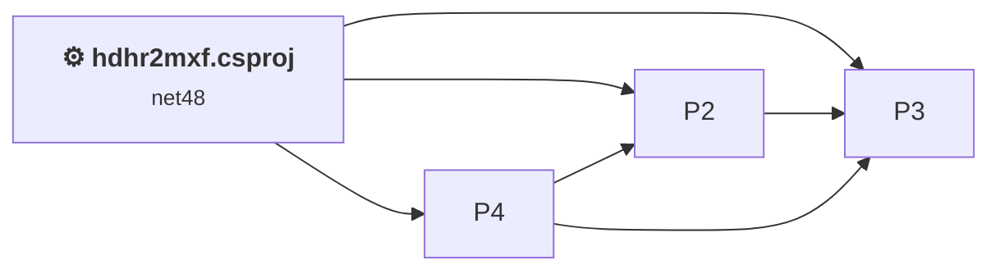
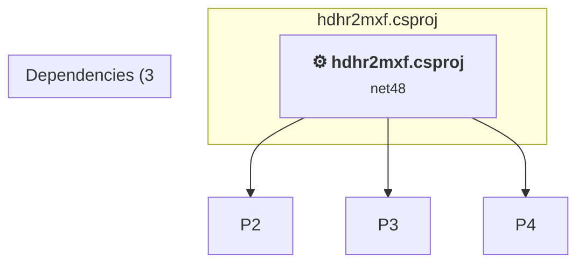

# Projects and dependencies analysis

This document provides a comprehensive overview of the projects and their dependencies in the context of upgrading to .NETCoreApp,Version=v10.0.

## Table of Contents

- [Executive Summary](#executive-Summary)
  - [Highlevel Metrics](#highlevel-metrics)
  - [Projects Compatibility](#projects-compatibility)
  - [Package Compatibility](#package-compatibility)
  - [API Compatibility](#api-compatibility)
  - [Binding Redirect Configuration](#binding-redirect-configuration)
- [Aggregate NuGet packages details](#aggregate-nuget-packages-details)
- [Top API Migration Challenges](#top-api-migration-challenges)
  - [Technologies and Features](#technologies-and-features)
  - [Most Frequent API Issues](#most-frequent-api-issues)
- [Projects Relationship Graph](#projects-relationship-graph)
- [Project Details](#project-details)

  - [%USERPROFILE%\source\repos\epg123\src\GaRyan2.MxfXmltvTools\GaRyan2.MxfXmltvTools.csproj](#%userprofile%sourcereposepg123srcgaryan2mxfxmltvtoolsgaryan2mxfxmltvtoolscsproj)
  - [%USERPROFILE%\source\repos\epg123\src\GaRyan2.Utilities\GaRyan2.Utilities.csproj](#%userprofile%sourcereposepg123srcgaryan2utilitiesgaryan2utilitiescsproj)
  - [%USERPROFILE%\source\repos\epg123\src\GaRyan2.WmcUtilities\GaRyan2.WmcUtilities.csproj](#%userprofile%sourcereposepg123srcgaryan2wmcutilitiesgaryan2wmcutilitiescsproj)
  - [hdhr2mxf.csproj](#hdhr2mxfcsproj)

## Executive Summary

### Highlevel Metrics

| Metric | Count | Status |
| :--- | :---: | :--- |
| Total Projects | 4 | 1 require upgrade |
| Total NuGet Packages | 0 | All compatible |
| Total Code Files | 81 |  |
| Total Code Files with Incidents | 3 |  |
| Total Lines of Code | 8642 |  |
| Total Number of Issues | 10 |  |
| Estimated LOC to modify | 7+ | at least 0.1% of codebase |

### Projects Compatibility

| Project | Target Framework | Difficulty | Package Issues | API Issues | Binding Issues | Est. LOC Impact | Description |
| :--- | :---: | :---: | :---: | :---: | :---: | :---: | :--- |
| [%USERPROFILE%\source\repos\epg123\src\GaRyan2.MxfXmltvTools\GaRyan2.MxfXmltvTools.csproj](#%userprofile%sourcereposepg123srcgaryan2mxfxmltvtoolsgaryan2mxfxmltvtoolscsproj) | net10.0-windows | ✅ None | 0 | 0 | 0 |  | ClassLibrary, Sdk Style = True |
| [%USERPROFILE%\source\repos\epg123\src\GaRyan2.Utilities\GaRyan2.Utilities.csproj](#%userprofile%sourcereposepg123srcgaryan2utilitiesgaryan2utilitiescsproj) | net10.0-windows | ✅ None | 0 | 0 | 0 |  | ClassLibrary, Sdk Style = True |
| [%USERPROFILE%\source\repos\epg123\src\GaRyan2.WmcUtilities\GaRyan2.WmcUtilities.csproj](#%userprofile%sourcereposepg123srcgaryan2wmcutilitiesgaryan2wmcutilitiescsproj) | net10.0-windows | ✅ None | 0 | 0 | 0 |  | ClassLibrary, Sdk Style = True |
| [hdhr2mxf.csproj](#hdhr2mxfcsproj) | net48 | 🟢 Low | 1 | 7 | 0 | 7+ | ClassicWinForms, Sdk Style = False |

### Package Compatibility

| Status | Count | Percentage |
| :--- | :---: | :---: |
| ✅ Compatible | 0 | 0.0% |
| ⚠️ Incompatible | 0 | 0.0% |
| 🔄 Upgrade Recommended | 0 | 0.0% |
| ***Total NuGet Packages*** | ***0*** | ***100%*** |

### API Compatibility

| Category | Count | Impact |
| :--- | :---: | :--- |
| 🔴 Binary Incompatible | 0 | High - Require code changes |
| 🟡 Source Incompatible | 1 | Medium - Needs re-compilation and potential conflicting API error fixing |
| 🔵 Behavioral change | 6 | Low - Behavioral changes that may require testing at runtime |
| ✅ Compatible | 776 |  |
| ***Total APIs Analyzed*** | ***783*** |  |

## Aggregate NuGet packages details

| Package | Current Version | Suggested Version | Projects | Description |
| :--- | :---: | :---: | :--- | :--- |

## Top API Migration Challenges

### Technologies and Features

| Technology | Issues | Percentage | Migration Path |
| :--- | :---: | :---: | :--- |

### Most Frequent API Issues

| API | Count | Percentage | Category |
| :--- | :---: | :---: | :--- |
| T:System.Uri | 2 | 28.6% | Behavioral Change |
| M:System.Uri.#ctor(System.String) | 1 | 14.3% | Behavioral Change |
| T:System.Xml.Serialization.XmlSerializer | 1 | 14.3% | Behavioral Change |
| T:System.Net.Http.HttpContent | 1 | 14.3% | Behavioral Change |
| M:System.Net.Http.HttpContent.ReadAsStreamAsync | 1 | 14.3% | Behavioral Change |
| M:System.Net.WebRequest.Create(System.String) | 1 | 14.3% | Source Incompatible |

## Projects Relationship Graph

Legend:
📦 SDK-style project
⚙️ Classic project

## Project Details

### hdhr2mxf.csproj

#### Project Info

- **Current Target Framework:** net48
- **Proposed Target Framework:** net10.0-windows
- **SDK-style**: False
- **Project Kind:** ClassicWinForms
- **Dependencies**: 3
- **Dependants**: 0
- **Number of Files**: 11
- **Number of Files with Incidents**: 3
- **Lines of Code**: 788
- **Estimated LOC to modify**: 7+ (at least 0.9% of the project)

#### Dependency Graph

Legend:
📦 SDK-style project
⚙️ Classic project

### API Compatibility

| Category | Count | Impact |
| :--- | :---: | :--- |
| 🔴 Binary Incompatible | 0 | High - Require code changes |
| 🟡 Source Incompatible | 1 | Medium - Needs re-compilation and potential conflicting API error fixing |
| 🔵 Behavioral change | 6 | Low - Behavioral changes that may require testing at runtime |
| ✅ Compatible | 776 |  |
| ***Total APIs Analyzed*** | ***783*** |  |

