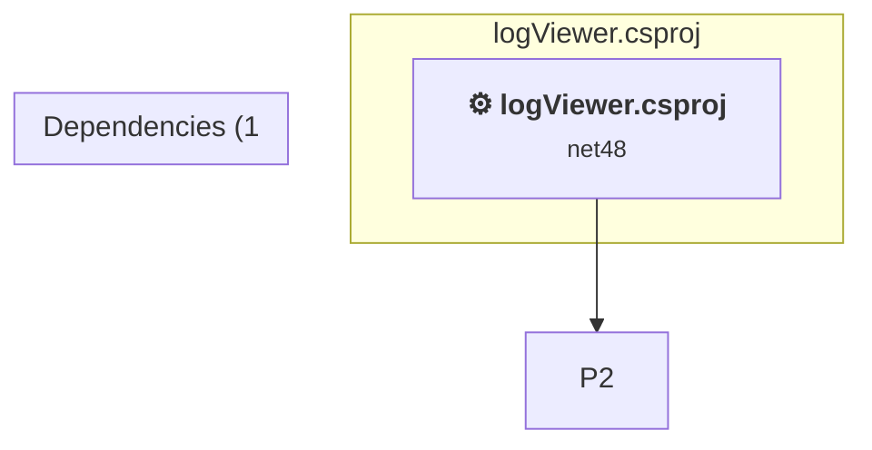

# Projects and dependencies analysis

This document provides a comprehensive overview of the projects and their dependencies in the context of upgrading to .NETCoreApp,Version=v10.0.

## Table of Contents

- [Executive Summary](#executive-Summary)
  - [Highlevel Metrics](#highlevel-metrics)
  - [Projects Compatibility](#projects-compatibility)
  - [Package Compatibility](#package-compatibility)
  - [API Compatibility](#api-compatibility)
  - [Binding Redirect Configuration](#binding-redirect-configuration)
- [Aggregate NuGet packages details](#aggregate-nuget-packages-details)
- [Top API Migration Challenges](#top-api-migration-challenges)
  - [Technologies and Features](#technologies-and-features)
  - [Most Frequent API Issues](#most-frequent-api-issues)
- [Projects Relationship Graph](#projects-relationship-graph)
- [Project Details](#project-details)

  - [%USERPROFILE%\source\repos\epg123\src\GaRyan2.Utilities\GaRyan2.Utilities.csproj](#%userprofile%sourcereposepg123srcgaryan2utilitiesgaryan2utilitiescsproj)
  - [logViewer.csproj](#logviewercsproj)

## Executive Summary

### Highlevel Metrics

| Metric | Count | Status |
| :--- | :---: | :--- |
| Total Projects | 2 | 1 require upgrade |
| Total NuGet Packages | 0 | All compatible |
| Total Code Files | 21 |  |
| Total Code Files with Incidents | 5 |  |
| Total Lines of Code | 3179 |  |
| Total Number of Issues | 452 |  |
| Estimated LOC to modify | 450+ | at least 14.2% of codebase |

### Projects Compatibility

| Project | Target Framework | Difficulty | Package Issues | API Issues | Binding Issues | Est. LOC Impact | Description |
| :--- | :---: | :---: | :---: | :---: | :---: | :---: | :--- |
| [%USERPROFILE%\source\repos\epg123\src\GaRyan2.Utilities\GaRyan2.Utilities.csproj](#%userprofile%sourcereposepg123srcgaryan2utilitiesgaryan2utilitiescsproj) | net10.0-windows | ✅ None | 0 | 0 | 0 |  | ClassLibrary, Sdk Style = True |
| [logViewer.csproj](#logviewercsproj) | net48 | 🟡 Medium | 0 | 450 | 0 | 450+ | ClassicWinForms, Sdk Style = False |

### Package Compatibility

| Status | Count | Percentage |
| :--- | :---: | :---: |
| ✅ Compatible | 0 | 0.0% |
| ⚠️ Incompatible | 0 | 0.0% |
| 🔄 Upgrade Recommended | 0 | 0.0% |
| ***Total NuGet Packages*** | ***0*** | ***100%*** |

### API Compatibility

| Category | Count | Impact |
| :--- | :---: | :--- |
| 🔴 Binary Incompatible | 421 | High - Require code changes |
| 🟡 Source Incompatible | 29 | Medium - Needs re-compilation and potential conflicting API error fixing |
| 🔵 Behavioral change | 0 | Low - Behavioral changes that may require testing at runtime |
| ✅ Compatible | 845 |  |
| ***Total APIs Analyzed*** | ***1295*** |  |

## Aggregate NuGet packages details

| Package | Current Version | Suggested Version | Projects | Description |
| :--- | :---: | :---: | :--- | :--- |

## Top API Migration Challenges

### Technologies and Features

| Technology | Issues | Percentage | Migration Path |
| :--- | :---: | :---: | :--- |
| Windows Forms | 421 | 93.6% | Windows Forms APIs for building Windows desktop applications with traditional Forms-based UI that are available in .NET on Windows. Enable Windows Desktop support: Option 1 (Recommended): Target net9.0-windows; Option 2: Add <UseWindowsDesktop>true</UseWindowsDesktop>; Option 3 (Legacy): Use Microsoft.NET.Sdk.WindowsDesktop SDK. |
| Legacy Configuration System | 17 | 3.8% | Legacy XML-based configuration system (app.config/web.config) that has been replaced by a more flexible configuration model in .NET Core. The old system was rigid and XML-based. Migrate to Microsoft.Extensions.Configuration with JSON/environment variables; use System.Configuration.ConfigurationManager NuGet package as interim bridge if needed. |
| GDI+ / System.Drawing | 10 | 2.2% | System.Drawing APIs for 2D graphics, imaging, and printing that are available via NuGet package System.Drawing.Common. Note: Not recommended for server scenarios due to Windows dependencies; consider cross-platform alternatives like SkiaSharp or ImageSharp for new code. |
| Windows Forms Legacy Controls | 1 | 0.2% | Legacy Windows Forms controls that have been removed from .NET Core/5+ including StatusBar, DataGrid, ContextMenu, MainMenu, MenuItem, and ToolBar. These controls were replaced by more modern alternatives. Use ToolStrip, MenuStrip, ContextMenuStrip, and DataGridView instead. |

### Most Frequent API Issues

| API | Count | Percentage | Category |
| :--- | :---: | :---: | :--- |
| T:System.Windows.Forms.ToolStripMenuItem | 40 | 8.9% | Binary Incompatible |
| T:System.Windows.Forms.Keys | 27 | 6.0% | Binary Incompatible |
| T:System.Windows.Forms.StatusStrip | 15 | 3.3% | Binary Incompatible |
| T:System.Windows.Forms.MenuStrip | 13 | 2.9% | Binary Incompatible |
| T:System.Windows.Forms.FormWindowState | 12 | 2.7% | Binary Incompatible |
| P:System.Configuration.ApplicationSettingsBase.Item(System.String) | 10 | 2.2% | Source Incompatible |
| T:System.Windows.Forms.ContextMenuStrip | 10 | 2.2% | Binary Incompatible |
| P:System.Windows.Forms.RichTextBox.ZoomFactor | 10 | 2.2% | Binary Incompatible |
| T:System.Windows.Forms.ToolStripStatusLabel | 9 | 2.0% | Binary Incompatible |
| T:System.Windows.Forms.OpenFileDialog | 8 | 1.8% | Binary Incompatible |
| P:System.Windows.Forms.ToolStripItem.Text | 7 | 1.6% | Binary Incompatible |
| P:System.Windows.Forms.ToolStripItem.Size | 7 | 1.6% | Binary Incompatible |
| P:System.Windows.Forms.ToolStripItem.Name | 7 | 1.6% | Binary Incompatible |
| P:System.Windows.Forms.KeyEventArgs.KeyCode | 7 | 1.6% | Binary Incompatible |
| T:System.Windows.Forms.ToolStripSeparator | 6 | 1.3% | Binary Incompatible |
| T:System.Windows.Forms.Application | 5 | 1.1% | Binary Incompatible |
| T:System.Windows.Forms.DialogResult | 5 | 1.1% | Binary Incompatible |
| P:System.Windows.Forms.Control.Name | 5 | 1.1% | Binary Incompatible |
| M:System.Windows.Forms.ToolStripMenuItem.#ctor | 5 | 1.1% | Binary Incompatible |
| M:System.Windows.Forms.Control.ResumeLayout(System.Boolean) | 4 | 0.9% | Binary Incompatible |
| P:System.Windows.Forms.RichTextBox.Text | 4 | 0.9% | Binary Incompatible |
| P:System.Windows.Forms.Control.Size | 4 | 0.9% | Binary Incompatible |
| T:System.Windows.Forms.ToolStripItemCollection | 4 | 0.9% | Binary Incompatible |
| M:System.Windows.Forms.ToolStripItemCollection.AddRange(System.Windows.Forms.ToolStripItem[]) | 4 | 0.9% | Binary Incompatible |
| E:System.Windows.Forms.ToolStripItem.Click | 4 | 0.9% | Binary Incompatible |
| M:System.Windows.Forms.Control.SuspendLayout | 4 | 0.9% | Binary Incompatible |
| P:System.Windows.Forms.Form.WindowState | 4 | 0.9% | Binary Incompatible |
| P:System.Windows.Forms.RichTextBox.TextLength | 4 | 0.9% | Binary Incompatible |
| T:System.Windows.Forms.Cursor | 4 | 0.9% | Binary Incompatible |
| P:System.Windows.Forms.Message.WParam | 3 | 0.7% | Binary Incompatible |
| M:System.Windows.Forms.Control.PerformLayout | 3 | 0.7% | Binary Incompatible |
| T:System.Windows.Forms.FormStartPosition | 3 | 0.7% | Binary Incompatible |
| T:System.Windows.Forms.Control.ControlCollection | 3 | 0.7% | Binary Incompatible |
| P:System.Windows.Forms.Control.Controls | 3 | 0.7% | Binary Incompatible |
| M:System.Windows.Forms.Control.ControlCollection.Add(System.Windows.Forms.Control) | 3 | 0.7% | Binary Incompatible |
| T:System.Windows.Forms.AutoScaleMode | 3 | 0.7% | Binary Incompatible |
| P:System.Windows.Forms.Control.TabIndex | 3 | 0.7% | Binary Incompatible |
| P:System.Windows.Forms.Control.Location | 3 | 0.7% | Binary Incompatible |
| P:System.Windows.Forms.RichTextBox.ForeColor | 3 | 0.7% | Binary Incompatible |
| T:System.Windows.Forms.DockStyle | 3 | 0.7% | Binary Incompatible |
| T:System.Windows.Forms.RightToLeft | 3 | 0.7% | Binary Incompatible |
| P:System.Windows.Forms.ToolStrip.Items | 3 | 0.7% | Binary Incompatible |
| M:System.Windows.Forms.TextBoxBase.ScrollToCaret | 3 | 0.7% | Binary Incompatible |
| M:System.Configuration.ApplicationSettingsBase.Save | 3 | 0.7% | Source Incompatible |
| F:System.Windows.Forms.FormWindowState.Maximized | 3 | 0.7% | Binary Incompatible |
| P:System.Windows.Forms.Form.Size | 3 | 0.7% | Binary Incompatible |
| P:System.Windows.Forms.Form.Location | 3 | 0.7% | Binary Incompatible |
| P:System.Windows.Forms.TextBoxBase.SelectionStart | 3 | 0.7% | Binary Incompatible |
| P:System.Windows.Forms.RichTextBox.SelectedText | 3 | 0.7% | Binary Incompatible |
| P:System.Windows.Forms.TextBoxBase.Lines | 3 | 0.7% | Binary Incompatible |

## Projects Relationship Graph

Legend:
📦 SDK-style project
⚙️ Classic project

## Project Details

### logViewer.csproj

#### Project Info

- **Current Target Framework:** net48
- **Proposed Target Framework:** net10.0-windows
- **SDK-style**: False
- **Project Kind:** ClassicWinForms
- **Dependencies**: 1
- **Dependants**: 0
- **Number of Files**: 10
- **Number of Files with Incidents**: 5
- **Lines of Code**: 1019
- **Estimated LOC to modify**: 450+ (at least 44.2% of the project)

#### Dependency Graph

Legend:
📦 SDK-style project
⚙️ Classic project

### API Compatibility

| Category | Count | Impact |
| :--- | :---: | :--- |
| 🔴 Binary Incompatible | 421 | High - Require code changes |
| 🟡 Source Incompatible | 29 | Medium - Needs re-compilation and potential conflicting API error fixing |
| 🔵 Behavioral change | 0 | Low - Behavioral changes that may require testing at runtime |
| ✅ Compatible | 845 |  |
| ***Total APIs Analyzed*** | ***1295*** |  |

#### Project Technologies and Features

| Technology | Issues | Percentage | Migration Path |
| :--- | :---: | :---: | :--- |
| GDI+ / System.Drawing | 10 | 2.2% | System.Drawing APIs for 2D graphics, imaging, and printing that are available via NuGet package System.Drawing.Common. Note: Not recommended for server scenarios due to Windows dependencies; consider cross-platform alternatives like SkiaSharp or ImageSharp for new code. |
| Windows Forms Legacy Controls | 1 | 0.2% | Legacy Windows Forms controls that have been removed from .NET Core/5+ including StatusBar, DataGrid, ContextMenu, MainMenu, MenuItem, and ToolBar. These controls were replaced by more modern alternatives. Use ToolStrip, MenuStrip, ContextMenuStrip, and DataGridView instead. |
| Legacy Configuration System | 17 | 3.8% | Legacy XML-based configuration system (app.config/web.config) that has been replaced by a more flexible configuration model in .NET Core. The old system was rigid and XML-based. Migrate to Microsoft.Extensions.Configuration with JSON/environment variables; use System.Configuration.ConfigurationManager NuGet package as interim bridge if needed. |
| Windows Forms | 421 | 93.6% | Windows Forms APIs for building Windows desktop applications with traditional Forms-based UI that are available in .NET on Windows. Enable Windows Desktop support: Option 1 (Recommended): Target net9.0-windows; Option 2: Add <UseWindowsDesktop>true</UseWindowsDesktop>; Option 3 (Legacy): Use Microsoft.NET.Sdk.WindowsDesktop SDK. |

